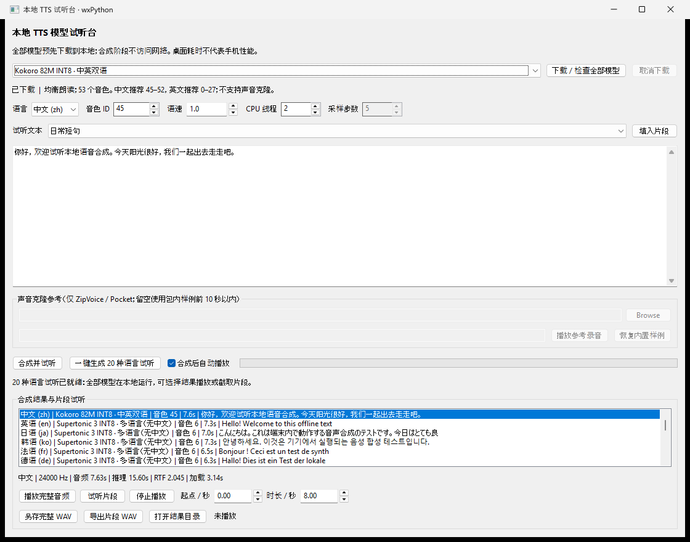
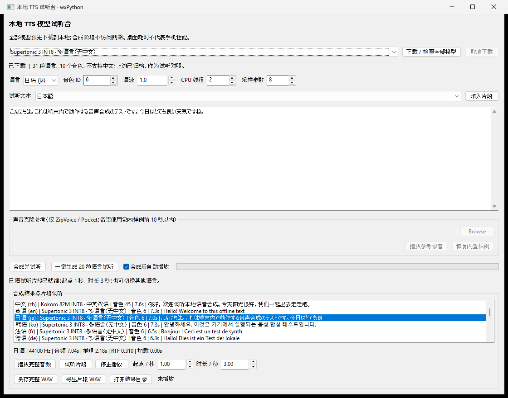

# tts-model-tryer

A local text-to-speech audition app built with **Python, wxPython/wxWidgets, and
sherpa-onnx**. Compare TTS models, listen to generated clips, try reference-audio
voice cloning, and measure native inference memory without a cloud TTS API.

[English setup](#quick-start-windows) | [中文说明](#中文说明)

## Screenshots

### Model audition and playback

Select a local model, edit the input text, choose a speaker, and play or export
the generated audio.



### Multilingual audition and segment preview

Generate the 20-language audition set, select a language-labelled result, and
preview a segment by setting its start time and duration.



These are screenshots of the native Windows application using built-in demo
text and locally generated audio. Models and audio files are downloaded or
generated during setup; they are not included in the repository.

## Features

- Seven model families and eight downloadable ONNX packages.
- Fully local CPU inference after downloading all models.
- Editable text, speaker selection, speaking speed, playback, and WAV export.
- Preview or export a segment by setting its start time and duration.
- One-click audition generation for 20 languages, with language-labelled history.
- Reference-audio voice cloning with ZipVoice and Pocket TTS.
- Reproducible Windows memory benchmarks: isolated processes, cold/warm inference,
  working-set peaks, and private committed memory.

The current GUI labels are in Chinese. This is a **desktop evaluation tool**, not
an Android/iOS app; desktop measurements do not establish mobile performance.

## Supported model packages

| Model package | Languages in this app | Notes |
| --- | --- | --- |
| Kokoro 82M INT8 v1.0 | Chinese, English | Chinese speaker IDs 45–52; English IDs 0–27 recommended |
| Matcha Baker + Vocos | Chinese | Fixed female voice; non-commercial dataset restriction |
| ZipVoice-Distill INT8 + Vocos | Chinese, English | Reference audio and matching transcript |
| KittenTTS Nano 0.8 INT8 | English | Eight preset speakers; not KittenTTS 2 |
| Pocket TTS INT8, 2026-01-26 | English | Reference audio; transcript not required |
| Piper huayan medium | Chinese | Fixed voice |
| Piper lessac medium INT8 | English | Fixed voice |
| Supertonic 3 INT8 | 31 languages, excluding Chinese | Ten speakers; upstream project is archived |

The 20-language audition uses Kokoro for Chinese and Supertonic 3 for English,
Japanese, Korean, French, German, Spanish, Portuguese, Italian, Russian, Arabic,
Hindi, Indonesian, Vietnamese, Turkish, Dutch, Polish, Swedish, Ukrainian, and
Romanian. **Not every model supports all 20 languages.**

## Quick start (Windows)

Tested on **Windows 11 x64, Python 3.13**, with CPU inference. Install
[Python](https://www.python.org/downloads/windows/) and
[Git](https://git-scm.com/downloads/win) first. Allow at least **3 GB of free disk
space** for dependencies, downloaded models, and temporary archives.

Run these commands in PowerShell:

```powershell
git clone https://github.com/liuxiaodong008008/tts-model-tryer.git
Set-Location tts-model-tryer

py -3.13 -m venv .venv
.\.venv\Scripts\python.exe -m pip install -r requirements.txt

# Download ALL model packages and required vocoders before using the app.
.\.venv\Scripts\python.exe prepare_models.py
.\.venv\Scripts\python.exe prepare_models.py --check

# Optional: generate 20 ready-to-play language clips.
.\.venv\Scripts\python.exe verify_models.py --audition-20

.\.venv\Scripts\python.exe app.py
```

The initial model download is approximately **770 MB**, with about **1 GB** of
extracted model files. Internet access is required for dependency installation
and model downloads; synthesis does not download models or call a cloud API.
Model binaries, generated audio, logs, benchmark reports, and `.venv` are
intentionally excluded from this Git repository.

For later launches, run `.\.venv\Scripts\python.exe app.py` or `.\run.ps1`.
The Python command does not require PowerShell script execution-policy changes.
If a package mirror returns a `.whl.metadata` 404, try:

```powershell
.\.venv\Scripts\python.exe -m pip install --use-deprecated=legacy-resolver -r requirements.txt
```

Do not disable TLS certificate verification. If downloads fail, check access to
GitHub release assets. Re-run `prepare_models.py` to reuse completed downloads;
partial downloads are restarted. Other desktop platforms have not been
validated, and wxPython may require platform-specific native dependencies.

## Using the app

1. Select a model, language, speaker ID, and preset text, or enter your own text.
2. Click **合成并试听** to synthesize; **合成后自动播放** enables automatic playback.
3. Select an item in the history list and click **播放完整音频** to play it.
4. Set the start time and duration, then click **试听片段** to preview a segment.
5. Use **另存完整 WAV** or **导出片段 WAV** to export the full audio or a clip.
6. Click **一键生成 20 种语言试听** to generate the multilingual audition set.

Generated WAV files and matching metadata are saved under `outputs/`.
The latest 40 local results are restored when the app starts. A batch does not
automatically play every clip. **停止批量** stops after the current clip finishes
and keeps completed results.

For voice cloning, choose a WAV, FLAC, or OGG reference file. Use clean speech,
preferably 3–10 seconds; custom recordings must not exceed 30 seconds. ZipVoice
also requires an accurate transcript. Leaving the reference empty uses the
bundled sample, capped at 10 seconds. Only clone voices you are authorized to use.
Microphone recording is not implemented.

## Tests and synthesis checks

```powershell
.\.venv\Scripts\python.exe -m unittest discover -s tests -v
.\.venv\Scripts\python.exe verify_models.py
.\.venv\Scripts\python.exe verify_models.py --models kokoro zipvoice
.\.venv\Scripts\python.exe verify_models.py --audition-20
```

Unit tests cover input validation, archive handling, audio clipping, metadata,
GUI interactions, batch cancellation, and Windows memory counters. Real synthesis
checks validate non-empty, non-silent audio and save JSON reports in `outputs/`.
They are not subjective listening-quality rankings.

## Native memory benchmarks (Windows only)

```powershell
.\.venv\Scripts\python.exe benchmark_memory.py
.\.venv\Scripts\python.exe benchmark_memory.py --models kokoro pocket --repeats 3 --threads 2 --interval-ms 20
```

The default benchmark runs three independent processes per model package, each
performing a cold and a warm synthesis. It uses Windows `GetProcessMemoryInfo`,
so native ONNX allocations are included, not just the Python heap. Phase peaks
are sampled every 20 ms; lifetime peaks come from Windows counters. RSS/working
set and private committed memory are different metrics.

Results are saved to `outputs/memory-benchmark/results.json` and `summary.csv`,
with generated audio and per-trial logs alongside them. Reports use MiB and
include the environment and measurement method. These short-text desktop tests
do not replace long-running stress tests or mobile-device measurements.

## Project files

| File | Purpose |
| --- | --- |
| [app.py](./app.py) | wxPython audition interface |
| [tts_backend.py](./tts_backend.py) | Model catalog, downloads, inference, and audio helpers |
| [prepare_models.py](./prepare_models.py) | Download all models or check local availability |
| [verify_models.py](./verify_models.py) | Generate and validate real audition audio |
| [benchmark_memory.py](./benchmark_memory.py) | Windows process-memory benchmark |
| [tests/](./tests/) | Backend, GUI, and memory-counter tests |

## Model sources and licensing

Downloads come from the official sherpa-onnx
[TTS releases](https://github.com/k2-fsa/sherpa-onnx/releases/tag/tts-models) and
[vocoder releases](https://github.com/k2-fsa/sherpa-onnx/releases/tag/vocoder-models).
This repository does not redistribute model weights or bundled reference audio.

Model code, converted weights, voices, datasets, and dependencies can have
different licenses. Check the terms for each asset before redistribution or
commercial use. In particular, the **Matcha Baker checkpoint uses a dataset
explicitly marked for non-commercial use**. Do not assume a model project's
source-code license covers all its weights or voices.

---

## 中文说明

Python + wxPython（wxWidgets）桌面 Demo，使用 sherpa-onnx 的 CPU 推理接口。
**全部模型先下载到本地，语音合成不会触发下载或调用云端 API。**

## 启动

当前项目使用 Windows Python 3.13 和独立的 `.venv` 环境：

```powershell
.\.venv\Scripts\python.exe prepare_models.py --check
.\.venv\Scripts\python.exe app.py
# 或
.\run.ps1
```

新环境安装与一次性下载：

```powershell
py -3.13 -m venv .venv
.\.venv\Scripts\python.exe -m pip install -r requirements.txt
.\.venv\Scripts\python.exe prepare_models.py
.\.venv\Scripts\python.exe verify_models.py
.\.venv\Scripts\python.exe app.py
```

若当前机器的包镜像返回 `.whl.metadata` 404，可使用
`python -m pip install --use-deprecated=legacy-resolver -r requirements.txt`。
不要关闭 TLS 校验。

## 已接入的模型

| 模型 | 本 Demo 语言 | 音色 / 参考录音 |
| --- | --- | --- |
| Kokoro 82M INT8 v1.0 | 中、英 | 53 音色；中文 45–52，英文推荐 0–27 |
| Matcha Baker + Vocos | 中文 | 固定女声 |
| ZipVoice-Distill INT8 + Vocos | 中、英 | 参考音频 + 准确转写文本；留空使用包内样例 |
| KittenTTS Nano 0.8 INT8 | 英文 | 8 音色；不是 KittenTTS 2 |
| Pocket TTS INT8 2026-01-26 | 英文 | 参考音频，无需转写；留空使用包内样例 |
| Piper huayan medium | 中文 | 固定音色 |
| Piper lessac medium INT8 | 英文 | 固定音色 |
| Supertonic 3 INT8 | 31 种语言，无中文 | 10 音色；上游已归档 |

所有包下载自 [sherpa-onnx 官方模型发布页](https://github.com/k2-fsa/sherpa-onnx/releases/tag/tts-models)；
声码器来自[官方声码器发布页](https://github.com/k2-fsa/sherpa-onnx/releases/tag/vocoder-models)。
首次下载总量约 0.77 GB，解压和安装依赖还需要额外磁盘空间。
压缩包在成功解压后删除；保留模型、许可证、说明文件及包内样例。

## 试听方法

1. 选择模型、语言、音色和预设文本，也可输入自己的内容。
2. 点击“合成并试听”，界面后台加载模型并合成，结果自动保存。
3. 选择历史结果，可重播完整音频；设置起点和时长，点击“试听片段”。
4. 支持导出完整 WAV 或截取的片段 WAV；再次启动会载入最近 40 条音频记录。
5. 已运行 `verify_models.py` 时，列表中会直接显示各模型生成的试听片段。

### 20 种常见语言试听

点击“一键生成 20 种语言试听”，或运行：

```powershell
.\.venv\Scripts\python.exe verify_models.py --audition-20
```

包含中文、英语、日语、韩语、法语、德语、西班牙语、葡萄牙语、意大利语、俄语、
阿拉伯语、印地语、印度尼西亚语、越南语、土耳其语、荷兰语、波兰语、瑞典语、
乌克兰语和罗马尼亚语。每种都有对应语言的预设文本。

中文使用 Kokoro 音色 45，其余 19 种使用 Supertonic 3 音色 6、8 步合成。
这不是所有模型都支持全部 20 种语言；界面的语言选项仍按模型实际支持范围显示。
列表显示中文语言名称及代码，可直接选中语言试听或导出片段。
批量任务不自动连播；点击“停止批量”会在当前片段完成后停止，已生成的结果保留。
全部使用已下载模型，不访问网络，也不会增加模型下载量。

ZipVoice / Pocket 支持导入 WAV、FLAC、OGG 参考录音，建议 3–10 秒干净人声，
最多 30 秒。内置样例统一使用前 10 秒以内（播放参考录音时也是同一片段），
避免 Pocket 包内较长录音增加推理负担。ZipVoice 自定义录音必须填写准确转写。内置样例仅用于模型效果演示；
使用自定义声音前应取得授权。此 Demo 不提供实时麦克风录音。

切换模型会释放上一个推理实例；同一模型和线程数重复合成复用实例。
下载可取消，模型加载和原生推理阶段不可立即中断，界面会提示等待。
语速设置为 0.5–2.0；采样步数仅适用于 ZipVoice、Pocket 和 Supertonic。

## 输出与验证

- `models/`：完整本地模型和共享声码器；`.ready` 表示解压完成。
- `outputs/*.wav`：真实合成的 16-bit PCM WAV。
- 同名 JSON：模型、文本、语言、音色、推理耗时、加载耗时和 WAV SHA-256。
- `outputs/verification.json`：逐模型真实合成检查报告。
- `outputs/audition-20.json`：命令行生成的 20 语种试听清单及检查结果。
- `tts-demo.log`：GUI 错误日志。

```powershell
.\.venv\Scripts\python.exe -m unittest discover -s tests -v
.\.venv\Scripts\python.exe verify_models.py
# 仅重新验证指定模型
.\.venv\Scripts\python.exe verify_models.py --models kokoro zipvoice
```

验证脚本检查非空、有效采样率、有限数值、最小时长、RMS 和输出文件大小，
并禁止合成期间通过 Python URL 接口访问网络。它验证可运行性，不是主观听感排名。
RTF = 推理耗时 / 音频时长，加载时间单列；桌面 CPU 结果不代表手机速度。

## Windows 原生内存实测

```powershell
.\.venv\Scripts\python.exe benchmark_memory.py
# 指定模型、每模型试验次数、CPU 线程和采样间隔
.\.venv\Scripts\python.exe benchmark_memory.py --models kokoro pocket --repeats 3 --threads 2 --interval-ms 20
```

默认对全部 8 个模型包分别运行 3 次，每次使用独立进程，先加载模型，再合成两遍相同文本，
记录首次推理和复用模型后的热启动推理。支持中文的包使用同一段中文，其余使用同一段英文。
线程数为 2；Supertonic 为 8 步，其他模型为 5 步（仅相应模型实际使用）。
ZipVoice/Pocket 使用与界面相同的内置参考录音。

使用 Windows `GetProcessMemoryInfo`，覆盖 ONNX、声码器、参考音频、Python 与原生分配，
**不是只测 Python 堆**。外部控制进程每 20ms 采样实际工作进程的：

- RSS/工作集：当前驻留物理内存，包含共享运行库页。
- PrivateUsage：进程私有提交量，不等同于当前占用的物理内存。
- 各阶段 RSS/私有提交峰值：采样得到，可能漏掉短于采样间隔的尖峰。
- 进程生命周期峰值：操作系统记录的 PeakWorkingSetSize 和 PeakPagefileUsage，
  不依赖 20ms 轮询捕捉瞬时峰值；包含加载、推理及输出保存阶段。

基线在导入运行库后、加载模型前记录。每次测量的进程不包含 wx 界面、历史音频列表、
采样控制进程或其他应用。模型间使用独立进程避免分配器与模型残留干扰。
加载与原生 `generate` 前后使用握手采样，推理计时不包含握手等待。
第二次推理前保留模型和分配器缓存，但不保留第一次的输出数组。

结果存入 `outputs/memory-benchmark/`：

- `results.json`：环境、方法、每次试验分阶段原始计数和汇总。
- `summary.csv`：可用 Excel 打开的汇总表，内存单位为 MiB（1024² 字节）。
- `audio/`：本次测试真正生成的音频，不混入 GUI 普通试听历史。
- 每次试验对应的日志：保留原生推理警告和异常信息。

汇总默认给出 3 次成功试验的中位数，另列进程 RSS 峰值的跨试验最大值。
报告会明确保留失败项，任何试验失败均返回非零退出码。
本测试仅说明 Windows CPU 上这些固定短文本的内存开销，不是长文本压力测试，
也不能代替 Android/iOS 真机峰值内存或内存预算测量。

模型代码、转换包、音色和依赖可能采用不同许可证。商用前应分别核对；
尤其不要把原始项目的代码许可自动当成所有音色权重的许可。
本 Demo 的 Matcha Baker 检查点来自明确标注仅限非商业用途的数据集，
请不要直接将这个检查点用于商业产品。
